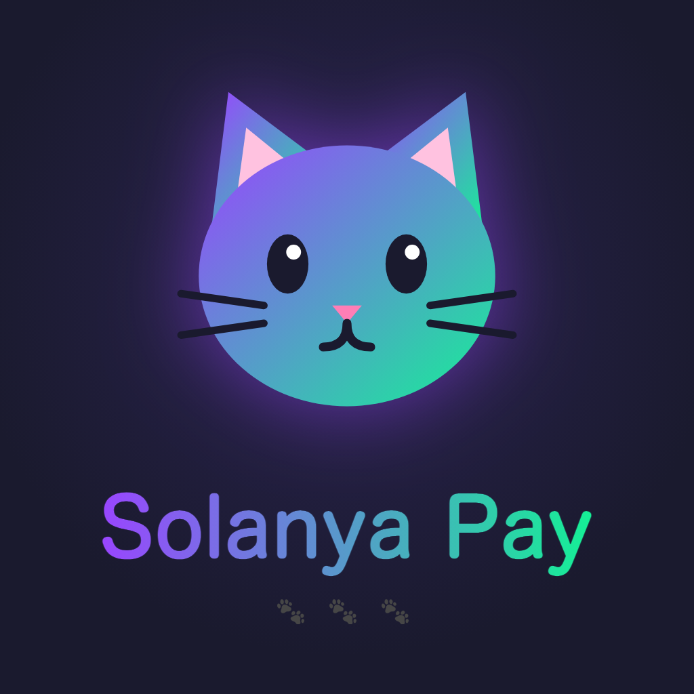
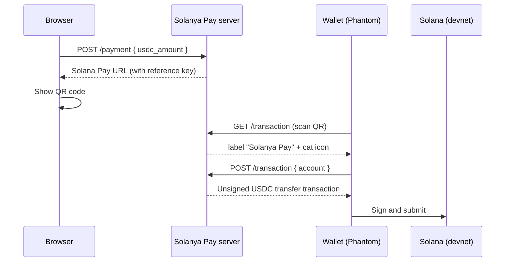

<p align="center">
  
</p>

<h1 align="center">Solanya Pay</h1>

<p align="center">Send USDC with Solana Pay, cat-style 🐾</p>

---

## Overview

Solanya Pay is a cat-themed USDC payment app built on [Solana Pay](https://docs.solanapay.com/) Transaction Requests.

1. Enter an amount, and Solanya Pay shows a QR code.
2. Scan it with a wallet like Phantom and approve.
3. USDC is sent to the recipient in seconds.

The server builds the transaction and hands it to the wallet, so users never type an address or amount by hand. The customer signs and submits the transaction from their own wallet, so the server never holds funds or private keys.

> Currently running on **devnet**.

## How it works



- The transaction contains:
  - an idempotent instruction that creates the recipient's USDC token account if it doesn't exist yet
  - an SPL Token `transferChecked` instruction that sends USDC from the customer to the recipient
- Each payment carries a unique `reference` public key. It is attached to the transfer instruction as a read-only key, so the payment can be found and matched on-chain.

## Tech stack

- [Solana Pay](https://github.com/anza-xyz/solana-pay) (Transaction Request flow)
- `@solana/web3.js` and `@solana/spl-token`
- USDC (SPL token, devnet mint `4zMMC9srt5Ri5X14GAgXhaHii3GnPAEERYPJgZJDncDU`)
- TypeScript + [Fastify](https://fastify.dev/)
- [Cloudflare Tunnel](https://developers.cloudflare.com/cloudflare-one/connections/connect-networks/) to expose the local server over HTTPS so mobile wallets can reach it

## Getting started

### Prerequisites

- Node.js 20+
- [`cloudflared`](https://github.com/cloudflare/cloudflared/releases)
- A mobile wallet (e.g. Phantom) switched to **devnet**, holding some devnet SOL for fees and devnet USDC ([Circle faucet](https://faucet.circle.com/))

### 1. Install dependencies

```bash
cd backend
npm install
```

### 2. Configure environment variables

Create `backend/src/.env.development`:

```bash
RECIPIENT_PUBKEY=<wallet address that receives USDC>
SOLANA_RPC_URL=https://api.devnet.solana.com
```

`BASE_URL` is written automatically by the start script.

### 3. Start the server and the tunnel

```bash
./src/start-development.sh
```

This script:

1. frees port 3000
2. starts a Cloudflare quick tunnel and writes its URL to `BASE_URL`
3. starts the server (`npm run dev`)

### 4. Pay

1. Open http://localhost:3000
2. Enter an amount and click **🐾 Generate QR code, nya**
3. Scan the QR code with your wallet and approve

The tunnel URL changes every time the script starts, so regenerate the QR code after a restart.

## API

| Method | Path | Description |
|---|---|---|
| `POST` | `/payment` | Takes `{ "usdc_amount": number }` and returns the Solana Pay URL and its `reference` |
| `GET` | `/transaction` | Solana Pay Transaction Request: returns the label and icon |
| `POST` | `/transaction?reference=...` | Solana Pay Transaction Request: takes `{ "account": string }` and returns the unsigned transaction (base64) |

## Project structure

```
backend/
  public/
    index.html            # UI
    icon.svg              # cat icon (logo, favicon, wallet icon, QR center)
  src/
    server.ts             # Fastify server
    env.ts                # loads .env.development / .env.production
    constants.ts          # USDC mint, recipient, base URL
    paymentStore.ts       # in-memory payment requests
    routes/payment.ts     # POST /payment
    routes/transaction.ts # Solana Pay Transaction Request
    start-development.sh  # tunnel + server
assets/
  solanya-pay-logo.png
```

## Roadmap

- Confirm payments automatically with `findReference` and show a success screen
- Expire unused payment requests
- Mainnet support

## Disclaimer

This is a hackathon demo running on Solana devnet. Do not use it with real funds.
